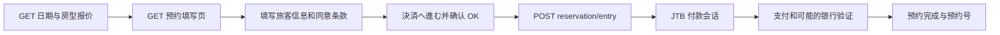

# 官网锁单机制调查

调查时间：2026-10-04。结论：**可确认预约入口提交发生在进入付款流程之前，不能确认此时是否锁房，也不能确认锁房时长。** 项目不会将“进入付款页”报告为已锁单。

## 当前官网流程

[酒店官网](https://www.kogetu.com/) 当前主预约入口使用 D-Reserve，酒店编号 `0000001834`。本次房型的活动付款方式是在线信用卡，支付代理为 JTB (`JBI`)；当前酒店配置 `additionalFeatures.cart=false`。

| 阶段 | 本次证据 | 可得出的结论 |
| --- | --- | --- |
| 打开预约填写页 | 公开初始数据中的 `reservedAt`、`reserveNumber` 为 null；无可见库存保留倒计时 | 页面没有提供已完成预约或锁房期限的证据；不能推断后端完全没有暂存 |
| 点击进入付款、确认 OK | 当前前端的 `callReservationEntryAjax` 发送预约 POST；实站验证捕获并拦截了相同入口 | 实际服务端变更入口是 `/guest-reserve-front/reservation/entry?hotelCode=0000001834` |
| POST 成功后 | 前端解析响应中的 `nextUrl`，跳转 JTB；`JBI` 分支准备付款返回地址 | 付款会话在提交入口之后创建/进入；后端是否同时扣减或暂占库存不在公开代码中 |
| 付款失败、停留或关闭 | 本次未创建真实付款会话；未观察到可靠的房间库存 TTL 字段 | 释放条件与分钟数未知，不能承诺 5/10/15/30 分钟 |
| 预约完成 | 必须核对预约完成页与预约号，必要时核对邮件 | 进入 JTB、已填卡或仅有跳转，都不是本工具的预约成功判据 |

前端把部分预约填写内容存入 `sessionStorage`，并带恢复页面信息。这用于表单恢复，**不能据此判断库存被保留**。工具不保存持久浏览器 profile。

## 验证范围

使用 2027-01-03～01-04、两名成人的“次の間タイプ和室”，方案 `PL00028608`、房型 `RM00010240`。公开搜索与填写页都返回合计 85,800 JPY。虚构旅客信息通过必填校验，进入付款按钮不再处于禁用样式。

测试在确认按钮之后捕获到预约 POST，但浏览器路由**拦截所有非 GET/HEAD 请求**，该 POST 没有发到酒店。没有创建预约、付款会话或扣款，也没有验证“等待 N 分钟是否释放库存”。[验证报告](LIVE_VALIDATION.json) 只保存公开候选信息、字段元数据和被拦截入口。

公开前端证据为调查时的 [预约表单代码](https://d-reserve.jp/guest-reserve-front/js/119.1c5f9f1531e9bf633abd.js)，其中的 `preparePayment`、`callReservationEntryAjax` 及 `nextUrl` 跳转可对应上述顺序。文件版本会随网站更新变化。

[JTB BOOK & PAY 官方 FAQ](https://www2.jtbbookandpay.com/FrontEnd/Content/faq.pdf) 描述预约完成邮件和预约确认流程，没有找到明确的客房暂占期限。FAQ 中的登录失败后短时间限制是登录保护，不能当作房间库存保留时间。

[Jeffligit/reservation_bot](https://github.com/Jeffligit/reservation_bot) 提到的短时 hold 针对其 SevenRooms 目标网站，不适用于湖月。[rommelniebres/Booking-Bot](https://github.com/rommelniebres/Booking-Bot) 的其他网站预订实现也不能证明湖月库存语义。

## 工具如何处理未知期限

- 到达 JTB 时记录 `PAYMENT_PAGE`，`holdConfirmed=false`、`holdExpiresAt=null`。
- `payment` 模式尽量自动填卡后交给你；`auto` 才会执行已配置的支付步骤。
- `handoffMinutes` 只控制本地接手等待时间，不计时或续期官网库存。
- 提交入口或支付有不确定响应时不重试，避免重复订单或扣款。
- 没有明确预约号时不宣称成功，停止自动下单，保留状态供核对。

若需知道准确期限，最可靠的是让酒店或其预约系统运营方确认。可使用以下询问文本（本项目未代你发送）：

> オンラインカード決済の入力画面へ進むと、客室の在庫は一時的に確保されますか。確保される場合、有効期限は何分ですか。支払い未完了の場合、自動解除されますか。

意为：进入在线信用卡填写页后是否暂时保留客房、保留多少分钟、未支付是否自动释放。收到答复或未来真实预约会话里的明确期限后，再据此实现有依据的库存倒计时。
