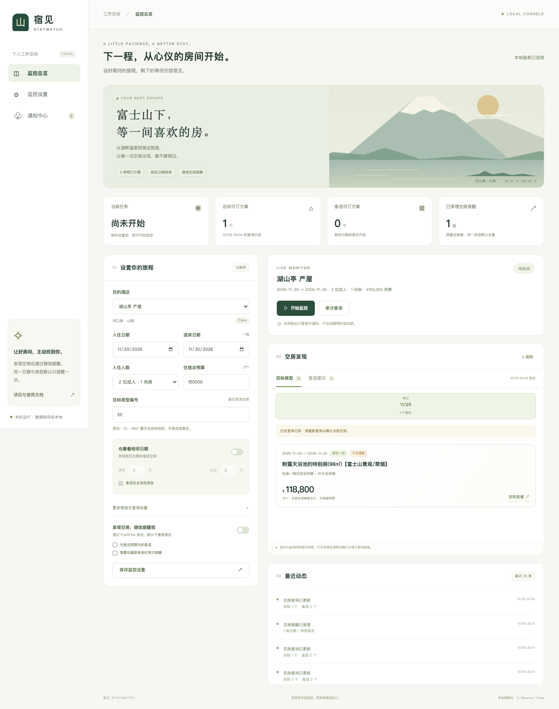

# 宿见 Staywatch · 酒店空房监控与预约助手

通过 Playwright 建立官网会话，查询空房、日期范围和不同房型备选，发送带持久去重的 PushPlus 通知。D-Reserve 支持湖月等酒店的表单填写和 JTB 付款流程；Tripla 支持产屋等酒店的查询及准备旅客信息页。默认配置只监控。酒店比较、取消政策澄清及复用方式见 [同架构酒店测试说明](HOTEL_TESTING.md)，产屋适配见 [UBUYA.md](UBUYA.md)。

**实站验证完成到预约提交入口，预约 POST 被拦截，没有创建订单。JTB 的真实付款会话及库存保留期限尚未验证。** 付款页的标准填卡支持与可配置步骤已经实现，并通过本地模拟测试；首次真实使用如遇不同字段、3-D Secure 或未知页面，会交给你操作。

## 可视化控制台（推荐）

需要 Node.js 22 或更新版本，首次使用执行：

```sh
git clone https://github.com/YuiLu/BookHotel.git
cd BookHotel
npm ci
npm run install:browser
npm run ui
```

打开 **http://127.0.0.1:4173**。不需要先手动创建配置或 `.env`；选好酒店、入住与退房日期、房型和预算后，点击「保存监控设置」。支持产屋、湖月、热海渚馆和冲绳 Kariyushi 预设，房型编号和方案编号可改。当前控制台为 **成人入住、1 间房**；多目标日期、儿童与预约准备等更完整配置仍使用下方命令行。

- **单次查询 / 开始监控 / 停止任务**：调用现有 Playwright 查询引擎，直接展示目标方案、备选报价、日期分布、取消限制和官网入口。
- **相邻日期**：可设置入住前后各几天，并选择是否包括其他房型。连续住宿晚数保持不变。
- **通知中心**：输入 PushPlus token，仅保存到本机 `.env`，页面不回显；可发送测试通知。还需在「监控设置」启用微信提醒并保存。
- **运行记录**：显示查询时间、错误和推送受理情况。历史快照有提示，不代表当前库存；受理数量按日期／房型组合计算，并非消息数。

控制台只做**监控与通知**，不提交预约或付款。它复用 CLI 的 `runtime` 和通知去重记录，跨页面刷新、进程重启仍保持去重。前端配置独立保存在 `dashboard.config.json`，不改动原来的示例或 CLI 配置。运行时同一酒店只能有一个查询进程；切换酒店或更改设置前需停止当前任务。

关闭浏览器标签页不会停止监控；退出 Node.js 服务、电脑休眠或关机将停止。服务重启后须手动重新开始。默认只监听本机 `127.0.0.1`，不提供互联网或局域网访问；端口冲突时可用 `PORT=4174 npm run ui`。

`.env`、`dashboard.config.json`、运行记录与浏览器缓存均不应提交到 Git。测试使用模拟酒店及模拟推送，不会创建真实订单或发真实微信；验证命令为 `npm test`。



*截图显示 2026-10-05 的历史查询记录；房型、报价与库存不代表实时可订状态。*

## 命令行快速开始

需要 Node.js 22 或更新版本。在项目目录执行：

```sh
npm ci
npm run install:browser
cp config.example.json config.json
cp .env.example .env
chmod 600 .env config.json
npm run check
npm run scan
npm start
```

先修改 `config.json` 中的日期、入住人数、房型和最高预算。示例是 **2027-04-03 入住、04-04 退房、两名成人、预算 100,000 JPY**；性别、交通方式和预算都是示例，须换成你的实际选择。日期必须写完整年份。

`scan` 只查一次，`start` 持续运行。目标默认每 120～140 秒查询，备选每 600 秒查询，遇到限流或网络错误会退避。关闭电脑、睡眠或退出进程都会停止轮询。在 macOS 上可用 `caffeinate -i npm start` 防止运行期间自动睡眠。

结果保存在：

- `runtime/<hotelCode>/availability.md`：可读的日期、房型、方案、报价和预算标记，带官网填写页链接。
- `runtime/<hotelCode>/availability.json`：完整结果，包含备选日期偏移和查询时间。
- `runtime/<hotelCode>/events.jsonl`：结果变化、错误、需要接手等事件。结果未变时不重复打印空房通知。
- `runtime/<hotelCode>/pushplus-state.json`：PushPlus 的持久通知去重记录，不包含 token。

`hotel.engine` 选择 `d-reserve` 或 `tripla`，`hotel.code` 配置酒店编号。D-Reserve 的 `hotel.questions` 配置其附加问题；原版配置不含 `hotel` 时仍默认湖月。见 `config.kariyushi.example.json` 与 `config.ubuya.example.json`。Tripla 运行记录分隔到 `runtime/tripla/<hotelCode>/`。

本项目是一间房的预约助手，支持连续多晚；不支持一次自动订多间房或组合房。儿童分类使用官网的 `childA/B/C/D/infant`，须按官网年龄、餐食和寝具说明确认；所有价格都是配置人数和全部晚数的合计，现场税费单独预留。

## PushPlus 微信空房提醒

在 [PushPlus 官网](https://www.pushplus.plus/) 获取自己的 token，并填入本地 `.env` 的 `PUSHPLUS_TOKEN`。仅监控时不需要旅客资料或支付信息。配置文件添加：

```json
"notifications": {
  "pushplus": {
    "enabled": true,
    "tokenEnv": "PUSHPLUS_TOKEN",
    "includeAlternatives": false,
    "notifyOnRestock": false,
    "rearmAfterMissingScans": 3,
    "timeoutSeconds": 10,
    "retrySeconds": 600,
    "maxAttempts": 3,
    "maxOffersInMessage": 10
  }
}
```

`config.monitor.jan3.example.json` 已配置 **2027-01-03～01-04 的次の間タイプ和室、2 位成人和 PushPlus**，可先用这个有房样本验证。真实 token 只放 `.env`：

```sh
npm run check -- --config config.monitor.jan3.example.json
npm run notify:test -- --config config.monitor.jan3.example.json
npm run scan -- --config config.monitor.jan3.example.json
npm start -- --config config.monitor.jan3.example.json
```

`notify:test` 只发一条测试消息，不查询酒店、不修改空房通知记录；每次手动运行都会发送。`scan` 和持续轮询都会在首次发现预算内的匹配空房时触发通知。消息包含日期、房型、最低匹配套餐报价及官网填写页链接，不创建预约。

默认按 **酒店编号 + 入住／退房日期 + 房型 + 入住人数** 持久去重。同一组合多个套餐合为一项；报价、套餐、查询时间改变，连续轮询、短暂消失再出现和进程重启均不会重复推送。新日期或新房型会触发新的提醒，同一轮新增组合合并成一条消息。消息最多展示 `maxOffersInMessage` 项，其余提示查看本地报告；全部组合都记录为已提醒。请保持同一个 runtime 目录：删除或改用新目录会失去既有去重记录。

`includeAlternatives: true` 会提醒前后日期及其他房型的**预算内、新鲜查询**结果，范围仍由 `alternatives` 配置。默认不推送备选或超预算报价。若希望同一房型卖完后重新放房时再次提醒，可设 `notifyOnRestock: true`；只有连续 `rearmAfterMissingScans` 次成功查询未见匹配报价，再出现时才重新提醒。查询错误和备选缓存不计入无房次数；此判断表示配置条件下无匹配报价，不能证明酒店所有库存售罄。

按 [PushPlus 官方 API 文档](https://www.pushplus.plus/doc/guide/api.html)，成功响应表示请求已受理，消息异步发送，须在微信确认实际收到。明确拒收会等待 `retrySeconds`，最多尝试 `maxAttempts` 次；超时、连接异常、5xx 或不明响应可能发生在服务端受理之后，记录为 `uncertain`，不会自动重发。发送前先保存 `pending`，进程中断后也不重复发送。不确定时先核对微信；如确实需要重新提醒，停掉监控后手动运行：

```sh
node src/cli.js notify-reset --config config.monitor.jan3.example.json
```

此命令只清除通知记录，下一轮可再推送，不改变预约保护状态。通知失败不会终止酒店监控，受理、拒收、不确定和本地错误可在 `events.jsonl` 查看。HTTPS POST 的 token 放请求体，不写入 URL 或日志；请勿把 token 贴到聊天或提交到 Git。

## 日期范围与备选房型

```json
{
  "stays": [{"checkIn": "2027-04-03", "checkOut": "2027-04-04"}],
  "alternatives": {
    "enabled": true,
    "daysBefore": 3,
    "daysAfter": 3,
    "allRoomTypes": true,
    "roomCodes": [],
    "roomKeywords": [],
    "includeOverBudget": true,
    "allowBooking": false,
    "intervalSeconds": 600
  }
}
```

这会查询 **03-31～04-06 的七个入住日**，退房日同步平移，住宿晚数保持一致。也会展示目标当天的其他房型。多个目标范围重叠时去重。

备选按“日期距离 → 是否符合目标房型/方案偏好 → 价格”排序。`includeOverBudget: true` 让你看见超预算房型，但它们不会被自动预约。`allRoomTypes: false` 时按备选的 `roomCodes` 和 `roomKeywords` 限定范围；列表为空代表不限。

`allowBooking` 默认 `false`，备选只展示建议。改为 `true` 后，只有目标无匹配报价时，才会尝试**刚查到、预算内**的最高排名备选；仍须通过相同的报价与取消政策检查。保留在文件里的旧建议不会触发自动预约。

目标筛选支持 `roomCodes`、`planCodes`、`roomKeywords`、`planKeywords`、`excludedKeywords`。同一列表中为“任一匹配”，不同条件之间为“全部满足”。备选查询保留排除关键词，但不沿用目标的计划编号和计划关键词。

`maxTotalJpy` 是预约总预算上限，判断为 `方案合计 + extraTaxBudgetJpy ≤ maxTotalJpy`。1 月 3 日验证方案的入汤税说明为每名成人每晚 150 JPY，两名成人一晚应预留 300 JPY；其他方案或人数要按实际说明调整。

“没有报价”可能表示未开放、售罄或条件不符。本次页面配置中出现 `reservableTerm: 180`；不能据此确定每天具体几点放房，也不能把范围外的零结果直接当成售罄。

## 自动化程度

下面的付款流程适用于 D-Reserve。**Tripla 目前支持 `monitor` 和 `prepare`**：自动选择唯一匹配报价，进入旅客信息页，填写姓名、邮箱及确认邮箱、电话；其他必填问题与地址等由你检查，脚本停在“下一步”之前。Tripla 的 `payment/auto` 会被配置校验拒绝；没有自动创建预约、填卡或锁单能力。选择多个套餐有歧义、价格或库存变化时停止，不按列表位置猜测。

| `checkout.mode` | 行为 |
| --- | --- |
| `monitor` | 只查询和推荐，不填写预约信息。可用无头浏览器。 |
| `prepare` | 找到房后打开填写页，自动填真实旅客信息，停在提交前供你检查。 |
| `payment` | 填表、确认取消政策、提交预约入口、进入 JTB 并尝试填卡，然后交给你完成付款。 |
| `auto` | 在上述步骤后，执行你配置并审阅过的 JTB 支付按钮步骤；遇到未知页面或银行验证时接手。未配置 `paymentSteps` 时会停在付款页。 |

`prepare/payment/auto` 使用可见浏览器。默认不注册会员、不添加额外选项、不应用优惠券。填写姓名读音、海外电话、旅客性别人数、到达时间、交通方式和付款方式。

`payment` 和 `auto` 都会发送预约 POST，可能产生服务端预约状态，必须配置：

```json
{
  "mode": "payment",
  "allowFinalSubmit": true,
  "acceptTermsAndPrivacy": true,
  "acceptedCancellationPolicySha256": "这里填写你审阅过的64位政策哈希"
}
```

先用 `inspect` 读取**你要订的方案**，查看 `runtime/<hotelCode>/review.json` 中的取消政策、税费和条款，再将对应哈希填入配置：

```sh
npm run inspect
# 也可以指定当次查询返回的计划和房型：
npm run inspect -- --plan PL00028608 --room RM00010240
```

`inspect` 只读，不填表、不提交；计划/房型仍须属于当前配置筛选出的有房方案。自动提交时若政策发生变化，会停下来。不要把验证用 1 月 3 日方案的哈希直接用于不同方案。

## 支付与旅客信息配置

将真实信息填写在项目目录的 `.env`，配置文件只引用环境变量名称：

```dotenv
GUEST_LAST_NAME=你的姓
GUEST_FIRST_NAME=你的名
GUEST_LAST_NAME_KANA=姓的平假名读音
GUEST_FIRST_NAME_KANA=名的平假名读音
GUEST_EMAIL=你的邮箱
GUEST_PHONE=138-1234-5678
CARD_NUMBER=卡号
CARD_HOLDER=持卡人英文姓名
CARD_EXP_MONTH=01
CARD_EXP_YEAR=2030
CARD_CVC=安全码
```

不要将真实信息贴到聊天或提交到 Git。`.env` 是本地明文文件，已列入 `.gitignore`，脚本不记录字段值、卡号、支付请求体、截图、HAR 或浏览器追踪。浏览器使用临时内存会话，不保存登录 profile。`CARD_*` 仅在 JTB 页面实际出现对应字段时读取。

海外在住设置通过 `checkout.overseas: true` 和 `countryCallingCode: "86"` 控制。官网号码是国家代码加三段号码，中国 11 位手机号也支持自动拆成 3/4/4。姓名读音需要平假名。`genderCounts` 要分别匹配所有非零年龄类别的人数。

JTB 页优先使用标准 `autocomplete="cc-number/cc-name/cc-exp-month/cc-exp-year/cc-csc"` 字段。实际页面不同，可在 `paymentFields` 配置精确选择器；合并有效期输入也应这样配置，而不是猜测格式：

```json
"paymentFields": [
  {"selector": "#实际卡号字段", "env": "CARD_NUMBER", "action": "fill"},
  {"selector": "#实际有效期字段", "env": "CARD_EXP_DATE", "action": "fill"}
]
```

`action` 支持 `fill/select/check`。`select` 的值是选项的 `value`，不是显示文字。普通补充旅客字段使用 `checkout.fields`。字段必须唯一且可见，否则停止。若卡字段在 iframe，需要同时配置 `frameUrlPrefix` 和该 iframe 的精确 HTTPS origin 到 `paymentFrameOrigins`：

```json
"paymentFrameOrigins": ["https://实际支付控件域名"],
"paymentFields": [
  {"frameUrlPrefix": "https://实际支付控件域名/card/", "selector": "#card-number", "env": "CARD_NUMBER"}
]
```

只在确认真实 JTB 会话后填写这些选择器。`runtime/<hotelCode>/form-metadata.json` 会记录控件名称、类型和 autocomplete，帮助配置；不会记录填写值。外层付款页面只接受 `www.jtbbookandpay.com` 和 `www2.jtbbookandpay.com` 的 HTTPS origin。

## 配置全自动支付步骤

真实 JTB 页面没有在本次测试中创建，因此项目没有预填未经验证的扣款按钮。首次使用 `payment` 模式确认页面后，可配置下面这种结构并切换 `auto`：

```json
"paymentSteps": [
  {
    "urlPrefix": "https://www2.jtbbookandpay.com/FrontEnd/实际页面路径",
    "readySelector": "#实际付款表单",
    "fields": [],
    "totalSelector": "#仅包含日元合计的元素",
    "buttonSelector": "#实际支付按钮",
    "buttonText": "实际按钮完整文字",
    "currencyText": "円"
  }
]
```

每一步核对 URL、金额和按钮完整文字，付款前也检查字段有效性。`totalSelector` 必须只包含一个整数金额及币种。出现验证码、3-D Secure、未知跳转、金额或条款变化时，停止自动点击并保持浏览器让你接手。

`handoffMinutes: 30` 只是**本工具等你操作的时间**，不是官网锁单期限。超时、Ctrl+C 或关闭窗口后，不自动重发预约或付款。成功必须在官网完成页识别到预约号；无法确认时记为 `UNVERIFIED`，应核对官网和邮件。

## 重启与重复提交保护

运行数据默认按酒店编号分隔到 `runtime/<hotelCode>/`，每个目录只有一个进程可运行。预约开始后先落盘状态；任何不确定状态、付款页或成功状态都会阻止再次启动下单。

如果进程意外退出，先核对官网和邮箱。确认没有成单之后才运行：

```sh
# 仅清理已经退出进程的锁，不修改预约状态
node src/cli.js unlock
# 你已核实没有预约成功，记录此结论并允许重试
node src/cli.js resolve --acknowledge-not-booked
```

两个命令支持 `--config PATH --runtime PATH`。从 1.0 升级时若旧 `runtime/state.json` 有未确认订单状态，先按旧 `--runtime runtime` 路径核实和处理；新目录不会绕过它。不要通过删除状态文件来跳过核对。一次查询可使用 `node src/cli.js run --once`；自定义 runtime 可分离不同配置，但不要并行运行重复目标的下单进程。

## 验证与调查资料

```sh
npm test
# 使用 config.validation.json 的有房方案，虚构旅客信息，拦截所有非 GET/HEAD 浏览器请求
npm run validate:live
```

测试覆盖连续 100 次轮询、重启、价格／套餐变化、备选通知、补房、发送失败与重复通知保护，以及 Tripla 的含税总价、日期与人数验证、匿名会话更新和旅客页准备流程，测试结果见 [VALIDATION.json](VALIDATION.json)。实站在 **2026-10-04 21:49（北京时间）** 两次查询 2027-01-03 的 `RM00010240 / PL00028608`，均检测到两名成人方案合计 85,800 JPY；使用模拟 PushPlus 响应验证监控重启后只触发一次通知，没有发送真实推送，微信送达尚未验证。

**2026-10-05 新增实站验证**：产屋 2026-11-29～11-30 的 98㎡特别房两次检测到 118,800 JPY、库存 1；成功进入旅客页并填好 5 个虚构联系字段，停在“下一步”前。真实 PushPlus 已受理测试消息和一条空房消息，100 次通知判断及再次查询未重复发送；实际微信接收需自行核对。可直接运行 `npm start -- --config config.ubuya.nov29.example.json`，完整说明见 [UBUYA.md](UBUYA.md)。

此前表单验证正确触发且拦截 `/guest-reserve-front/reservation/entry`；另用同一核心验证沖縄かりゆし的实站表单与预约入口，报告见 [Kariyushi 验证结果](examples/kariyushi-live-validation.json)。测试不创建真实预约，不验证付款后的服务端状态。之后房价或库存可能变化，验证配置没有房时需要先换成公开查询返回的实际有房方案。

- [实站验证结果](LIVE_VALIDATION.json)
- [1 月 3 日监控查询结果](examples/jan3-monitor-scan.md)
- [实站监控与模拟推送去重验证](examples/jan3-monitor-validation.json)
- [七天范围查询样本](examples/range-scan.json)
- [锁单机制调查与证据](LOCK_MECHANISM.md)

参考 [Jeffligit/reservation_bot](https://github.com/Jeffligit/reservation_bot) 的公开接口轮询、浏览器接管与付款控件处理思路，以及 [rommelniebres/Booking-Bot](https://github.com/rommelniebres/Booking-Bot) 的配置化运行、备选优先级和 dry-run 思路。此处按湖月当前网站重新实现，没有直接移植其他站点的选择器或库存保留时间。
